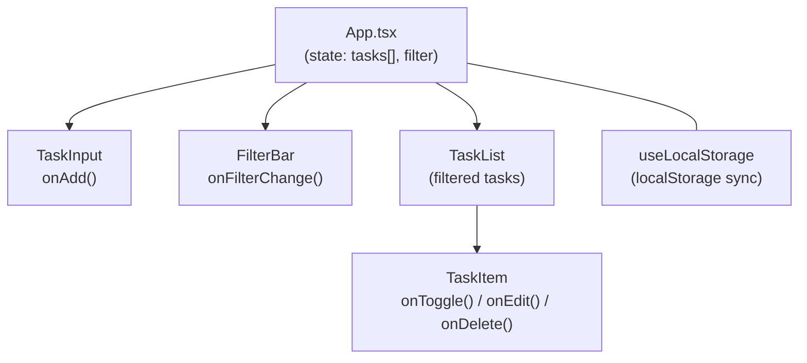

# To-Do List App — Implementation Plan

## Goal
Build a single-page To-Do List application with **React + TypeScript + Vite + Tailwind CSS** that supports adding, editing, deleting, completing tasks, filtering by status, and persisting state to `localStorage`.

---

## Agreed Design Decisions

| Decision | Choice |
|---|---|
| Framework | React (via Vite) |
| Language | TypeScript |
| Styling | Tailwind CSS |
| Task fields | `id`, `title`, `completed` |
| Empty input handling | Trim whitespace; block submission if empty |
| Filtering | All / Active / Completed tabs |
| Delete confirmation | No — immediate delete |
| Edit UX | Pencil icon → swaps title to inline input field |
| Persistence | `localStorage` |

---

## Data Model

```typescript
interface Task {
  id: string;        // crypto.randomUUID()
  title: string;     // trimmed, non-empty
  completed: boolean; // default: false
}

type Filter = 'all' | 'active' | 'completed';
```

---

## Proposed File Structure

```
ShopBackOA/
├── AGENTS.md
├── .gitignore
├── index.html                  # [NEW] Vite entry HTML
├── package.json                # [NEW] dependencies & scripts
├── tsconfig.json               # [NEW] TypeScript config (Vite default)
├── tsconfig.app.json           # [NEW] App-specific TS config
├── tsconfig.node.json          # [NEW] Node-specific TS config
├── vite.config.ts              # [NEW] Vite configuration
├── tailwind.config.js          # [NEW] Tailwind configuration
├── postcss.config.js           # [NEW] PostCSS (required by Tailwind)
├── src/
│   ├── main.tsx                # [NEW] React entry point
│   ├── App.tsx                 # [NEW] Root component
│   ├── index.css               # [NEW] Tailwind directives
│   ├── types/
│   │   └── task.ts             # [NEW] Task & Filter type definitions
│   ├── hooks/
│   │   └── useLocalStorage.ts  # [NEW] Custom hook for localStorage
│   ├── components/
│   │   ├── TaskInput.tsx       # [NEW] Add-task input + button
│   │   ├── TaskList.tsx        # [NEW] Renders filtered list of TaskItems
│   │   ├── TaskItem.tsx        # [NEW] Single task row (checkbox, title, edit, delete)
│   │   └── FilterBar.tsx       # [NEW] All / Active / Completed tabs
│   └── utils/
│       └── storage.ts          # [NEW] localStorage read/write helpers
```

---

## Proposed Changes

### Milestone 1 — Project Scaffolding

Scaffold the Vite + React + TypeScript project and install Tailwind CSS.

**Steps:**
1. Run `npm create vite@latest . -- --template react-ts` to scaffold in-place
2. Run `npm install`
3. Install Tailwind: `npm install -D tailwindcss @tailwindcss/vite`
4. Configure Tailwind plugin in `vite.config.ts`
5. Replace `src/index.css` with Tailwind directives (`@import "tailwindcss"`)
6. Clean up boilerplate files (remove default App.css, assets, logo, etc.)
7. Update `.gitignore` to include `node_modules/`, `dist/`, `.vite/`
8. Verify `npm run dev` starts without errors

---

### Milestone 2 — Types & Storage Utilities

#### [NEW] `src/types/task.ts`
Define `Task` interface and `Filter` type.

```typescript
export interface Task {
  id: string;
  title: string;
  completed: boolean;
}

export type Filter = 'all' | 'active' | 'completed';
```

#### [NEW] `src/utils/storage.ts`
Provide `loadTasks()` and `saveTasks()` helpers that read/write `Task[]` from `localStorage` under a `"todo-tasks"` key with JSON serialization.

#### [NEW] `src/hooks/useLocalStorage.ts`
Custom React hook that wraps `useState` with automatic `localStorage` sync:
```typescript
function useLocalStorage<T>(key: string, initialValue: T): [T, React.Dispatch<React.SetStateAction<T>>]
```
- Reads from `localStorage` on mount (falls back to `initialValue`)
- Writes to `localStorage` on every state change via `useEffect`

---

### Milestone 3 — Core Components

#### [NEW] `src/components/TaskInput.tsx`
- Controlled text input + "Add" button
- On submit: trims input, blocks if empty, calls `onAdd(title)`, clears input
- Submit on **Enter** key or button click

#### [NEW] `src/components/TaskItem.tsx`
- Displays a single task row with:
  - **Checkbox** — toggles `completed` status
  - **Title** — shows task title (strikethrough + muted when completed)
  - **Edit button** (pencil icon) — swaps title into an input field; save on Enter / blur
  - **Delete button** (trash icon) — immediately removes the task
- Edit mode: same trim + block-empty validation; revert to original if empty on blur

#### [NEW] `src/components/TaskList.tsx`
- Receives `tasks[]`, `filter`, and action callbacks
- Filters tasks based on current filter
- Maps to `<TaskItem />` components
- Shows an empty-state message when filtered list is empty

#### [NEW] `src/components/FilterBar.tsx`
- Three tab buttons: **All** / **Active** / **Completed**
- Highlights the active filter
- Optionally shows count of remaining active tasks

---

### Milestone 4 — App Assembly & Wiring

#### [MODIFY] `src/App.tsx`
Wire everything together:
- Use `useLocalStorage` hook to manage `Task[]` state
- Use `useState` for `Filter` state
- Define handlers: `addTask`, `toggleTask`, `editTask`, `deleteTask`
- Render: `<TaskInput />` → `<FilterBar />` → `<TaskList />`
- Centered card layout with Tailwind (max-w, shadow, rounded)

#### [MODIFY] `src/main.tsx`
Ensure it renders `<App />` into `#root` (should already be correct from Vite scaffold).

---

## Component Interaction Diagram



---

## Verification Plan

### Automated Tests
```bash
npm run build        # Ensure zero TypeScript/build errors
```

### Manual Verification
After each milestone:
1. `npm run dev` — app loads without console errors
2. **Add task** — type text, press Enter or click Add; task appears in list
3. **Empty input** — verify blank/whitespace-only input is blocked silently
4. **Toggle complete** — checkbox strikes through the title
5. **Edit task** — pencil icon reveals input; save on Enter; revert if empty on blur
6. **Delete task** — trash icon removes task immediately
7. **Filters** — All/Active/Completed tabs show correct subsets
8. **Persistence** — refresh the page; tasks survive via localStorage

---

## Milestones Summary

| # | Milestone | Deliverable |
|---|---|---|
| 1 | Project Scaffolding | Vite + React + TS + Tailwind running, boilerplate cleaned |
| 2 | Types & Storage | `Task` type, `useLocalStorage` hook, storage utils |
| 3 | Core Components | `TaskInput`, `TaskItem`, `TaskList`, `FilterBar` |
| 4 | App Assembly & Wiring | Everything wired in `App.tsx`, fully functional app |
